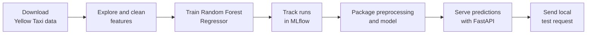

# Model Deployment Project

Use this repository as a **template** for your model deployment project. You will train a regression model that predicts the duration of NYC Yellow Taxi trips, track your experiments locally with MLflow, and serve predictions through a FastAPI app on your own machine. Create pull requests in your own copy even if you are working alone, and use them to track your progress.

## Learning Objectives

By the end of this repository, you should be able to:

- Build an end-to-end regression workflow for real-world taxi trip data.
- Separate exploration, preprocessing, training, and serving concerns into maintainable code.
- Track experiments locally with MLflow and compare model runs.
- Serve model predictions through a local API.

## Learning Path



| File / Folder | Description |
|---|---|
| [**Project Description**](project-description.md) | The assignment tasks, suggested workflow, repository layout, and stretch goals. |

### Additional Folders and Files

| File / Folder | Description |
|---|---|
| [**pyproject.toml**](pyproject.toml) | Project configuration and dependencies. |
| [**uv.lock**](uv.lock) | Dependency lock file. |

## Setup

Use [uv](https://docs.astral.sh/uv/getting-started/installation/) 0.13.5 or newer
and Python 3.13.17 or a newer 3.13 patch release, as defined in
[`.python-version`](.python-version).

> [!NOTE]
> Throughout these steps, text in angle brackets like `<repo-name>` is a **placeholder**. Replace it, including the `< >` brackets, with your own value. For example, `cd <repo-name>` becomes `cd mle-model-deployment-project`.

### 1. Create the Repository from the Template

Click **Use this template** on GitHub.

When creating the repository:

- Set yourself as the **Owner**
- Choose a repository name
- Disable **Include all branches**
- Click **Create repository**

> [!IMPORTANT]
> If you are working in pairs or groups, only **one person** should complete this step.

---

### 2. Add Collaborators (Pairs/Groups Only)

If working with teammates:

1. Open the repository on GitHub
2. Go to **Settings → Collaborators**
3. Add your teammates as collaborators
4. Share the repository link with your team

Teammates should accept the invitation before continuing.

---

### 3. Clone the Repository

Copy the SSH URL from the **Code** button on GitHub, then run:

```bash
git clone <copied-ssh-url>
```

The copied SSH URL will look like `git@github.com:<your-username>/<repo-name>.git`.

---

### 4. Move into the Project Folder and Install Dependencies

This installs all dependencies and creates a virtual environment in `.venv/`.

```bash
cd <repo-name>
uv sync
```

---

### 5. Open the Repository in VS Code

> [!NOTE]
> Make sure you open VS Code from the project root so it automatically detects the environment created by `uv sync`.

Launch VS Code in the project root folder:

```bash
code .
```

If you create a notebook to explore the data, select the Python environment created by `uv sync` as the kernel.

## How to Use This Repo

1. Read the assignment brief in [project-description.md](project-description.md).
2. Download and inspect the January 2025 Yellow Taxi dataset.
3. Train a baseline `RandomForestRegressor` and track runs locally with MLflow.
4. Refactor preprocessing and training logic into reusable Python modules.
5. Build a local prediction API with FastAPI.
6. Send a test request to the API and document the outcome in your README or PR.

### Working Locally

```bash
uv run python -m src.data                 # download January 2025 (about 60 MB) into data/
uv run python -m src.train                # baseline RandomForestRegressor -> MLflow + artifacts/model.skops
uv run python -m src.tune --trials 20     # stretch: Optuna search + tuned model, compared with the baseline
uv run python -m pytest                   # 10 tests: data cleaning, features, model files, API
```

MLflow UI (MLflow 3.17 no longer accepts a plain `./mlruns` folder as the tracking store, so runs
are kept in `mlflow.db` with the model files in `mlruns/`):

```bash
uv run mlflow ui --backend-store-uri sqlite:///mlflow.db --port 5000
```

Run the API and send the sample request:

```bash
uv run uvicorn app.main:app --reload --port 8000
curl -X POST http://127.0.0.1:8000/predict -H "Content-Type: application/json" -d @sample-request.json
```

Or in Docker (the model is mounted from `artifacts/`, host port 8004):

```bash
docker compose up -d --build
curl http://127.0.0.1:8004/health
```

## Project Layout

| Path | What it does |
|---|---|
| `src/data.py` | Downloads the January 2025 file; adds `duration` (minutes); keeps 1-60 min, 0-100 miles, January pickups |
| `src/features.py` | The 5 features used by training and the API: pickup zone, dropoff zone, distance, pickup hour, weekday |
| `src/train.py` | Trains a `RandomForestRegressor`, logs params, RMSE, MAE and the model to MLflow, saves `artifacts/model.skops` |
| `src/tune.py` | Optuna search (20 trials, nested MLflow runs), retrains the best parameters, compares with the baseline |
| `src/model_io.py` | Saves and loads the model with skops (only the forest's tree type is trusted) |
| `app/` | FastAPI: `GET /health`, `POST /predict`, `POST /predict_batch`; model loaded once |
| `notebooks/01-explore-and-compare.ipynb` | Data checks, cleaning rules, feature correlation, MLflow comparison |
| `tests/` | 10 pytest tests |

## Results

January 2025: 3,475,226 trips, **3,339,084 after cleaning** (96.1%). 80/20 split with seed 42; models
train on a 500,000-row sample of the 80% and are scored on the full validation set of **667,817 trips**.

| Model | RMSE (min) | MAE (min) | Fit time | Model size |
|---|---|---|---|---|
| Predict the mean duration | 9.78 | | | |
| **Baseline** `RandomForestRegressor` (100 trees, depth 20, min leaf 10) | **4.10** | 2.76 | 9.9 s | 291 MB |
| Tuned with Optuna (100 trees, depth 26, min leaf 3, 60% features) | 4.03 | 2.71 | 6.7 s | 1,153 MB |

Optuna: 20 trials on a 200,000-row sample, search RMSE 4.136 (best) to 4.333 (worst).

**Was tuning worth it?** Not for this API. The tuned forest is 0.07 minutes (about 4 seconds, 1.7%)
better but four times larger, because deeper trees with smaller leaves store many more nodes.
The API therefore serves the baseline model.

API check (`uvicorn`, baseline model): `sample-request.json` (zone 161 → 236, 2.5 miles, Wednesday
08:30) → **18.36 minutes** in 0.04 s. The same trip at 03:00 → 11.23 min and at 17:30 → 17.13 min;
JFK (132) → Times Square (230), 17 miles at 17:30 → 49.09 min. Invalid input (zone 999,
distance 0, missing time) → HTTP 422.

### Answers

1. **What is the RMSE of your final model?** **4.10 minutes** on 667,817 validation trips (MAE 2.76),
   for the served baseline. The tuned model reaches 4.03 but was not adopted.
2. **What would you do differently with more time?**
   - Add features that explain the remaining error: route-level average speed by hour, airport
     flags, and weather or traffic for the day.
   - Try gradient boosting (LightGBM or HistGradientBoosting): usually as accurate as a forest
     with a model a fraction of the size.
   - Validate on February 2025, not just a random January split, to see how it holds up over time.
   - Load the model from the MLflow Model Registry by alias instead of a file, and add CI that
     runs the tests and builds the image.
