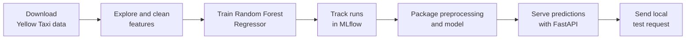

# Model Deployment Project

Use this repository as a **template** for your model deployment project. You will train a regression model that predicts the duration of NYC Yellow Taxi trips, track your experiments locally with MLflow, and serve predictions through a FastAPI app on your own machine. Create pull requests in your own copy even if you are working alone, and use them to track your progress.

## Learning Objectives

By the end of this repository, you should be able to:

- Build an end-to-end regression workflow for real-world taxi trip data.
- Separate exploration, preprocessing, training, and serving concerns into maintainable code.
- Track experiments locally with MLflow and compare model runs.
- Serve model predictions through a local API.

## Learning Path



| File / Folder | Description |
|---|---|
| [**Project Description**](project-description.md) | The assignment tasks, suggested workflow, repository layout, and stretch goals. |

### Additional Folders and Files

| File / Folder | Description |
|---|---|
| [**pyproject.toml**](pyproject.toml) | Project configuration and dependencies. |
| [**uv.lock**](uv.lock) | Dependency lock file. |

## Setup

Use [uv](https://docs.astral.sh/uv/getting-started/installation/) 0.13.5 or newer
and Python 3.13.17 or a newer 3.13 patch release, as defined in
[`.python-version`](.python-version).

> [!NOTE]
> Throughout these steps, text in angle brackets like `<repo-name>` is a **placeholder**. Replace it, including the `< >` brackets, with your own value. For example, `cd <repo-name>` becomes `cd mle-model-deployment-project`.

### 1. Create the Repository from the Template

Click **Use this template** on GitHub.

When creating the repository:

- Set yourself as the **Owner**
- Choose a repository name
- Disable **Include all branches**
- Click **Create repository**

> [!IMPORTANT]
> If you are working in pairs or groups, only **one person** should complete this step.

---

### 2. Add Collaborators (Pairs/Groups Only)

If working with teammates:

1. Open the repository on GitHub
2. Go to **Settings → Collaborators**
3. Add your teammates as collaborators
4. Share the repository link with your team

Teammates should accept the invitation before continuing.

---

### 3. Clone the Repository

Copy the SSH URL from the **Code** button on GitHub, then run:

```bash
git clone <copied-ssh-url>
```

The copied SSH URL will look like `git@github.com:<your-username>/<repo-name>.git`.

---

### 4. Move into the Project Folder and Install Dependencies

This installs all dependencies and creates a virtual environment in `.venv/`.

```bash
cd <repo-name>
uv sync
```

---

### 5. Open the Repository in VS Code

> [!NOTE]
> Make sure you open VS Code from the project root so it automatically detects the environment created by `uv sync`.

Launch VS Code in the project root folder:

```bash
code .
```

If you create a notebook to explore the data, select the Python environment created by `uv sync` as the kernel.

## How to Use This Repo

1. Read the assignment brief in [project-description.md](project-description.md).
2. Download and inspect the January 2025 Yellow Taxi dataset.
3. Train a baseline `RandomForestRegressor` and track runs locally with MLflow.
4. Refactor preprocessing and training logic into reusable Python modules.
5. Build a local prediction API with FastAPI.
6. Send a test request to the API and document the outcome in your README or PR.

### Working Locally

```bash
uv run python -m src.data                          # download January 2025 (about 60 MB) into data/
uv run python -m src.checks                        # data checks: raw vs cleaned January
uv run python -m src.train                         # RandomForest baseline (the assignment) -> MLflow
uv run python -m src.compare                       # 6 approaches on 500k rows, scored on January + February 2025
uv run python -m src.compare --models hgb --train-size 0 --save hgb   # the served model (all 2.67M rows)
uv run python -m src.long_trips                    # long-trip experiment: route features, live traffic, weather
uv run python -m src.time_validation               # train 1-24 Jan, validate 25-31 Jan and February
uv run python -m src.multi_month [--live-traffic]  # Nov 2024 - Jan 2025 training, tested on February
uv run python -m src.drift                         # PSI drift check per month against January
uv run python -m src.intervals                     # 10th/90th percentile models: the API returns a range
uv run python -m src.registry                      # register artifacts/model.skops as taxi-duration@champion
uv run python -m src.monitor                       # February day by day; reports/monitoring_2025-02.csv
uv run python -m src.tune --trials 20              # stretch: Optuna for the RandomForest
uv run python -m src.tune --model hgb --trials 20  # Optuna for HistGradientBoosting
uv run python -m pytest                            # 15 tests
```

On macOS, XGBoost and LightGBM need OpenMP once: `brew install libomp`.

### Where to look at the results

| What | Start it | Open |
|---|---|---|
| MLflow: every run, parameters, metrics, models | `uv run mlflow ui --backend-store-uri sqlite:///mlflow.db --port 5003` | <http://127.0.0.1:5003>, experiment `yellow-taxi-duration` |
| Optuna dashboard: both searches, trial history, parameter importance | `uv run optuna-dashboard sqlite:///optuna.db --port 8085` | <http://127.0.0.1:8085> |
| Prediction API | `docker compose up -d --build` | <http://127.0.0.1:8004/docs> |

MLflow 3.17 no longer accepts a plain `./mlruns` folder as the tracking store, so runs are kept
in `mlflow.db` with the model files in `mlruns/`. In MLflow, expand `optuna-search` or
`optuna-search-hgb` to see the 20 trials; select them and press **Compare** for a
parallel-coordinates plot. In the Optuna dashboard, open `rf-search` or `hgb-search`.

Run the API and send the sample request:

```bash
uv run uvicorn app.main:app --reload --port 8000
curl -X POST http://127.0.0.1:8000/predict -H "Content-Type: application/json" -d @sample-request.json
```

### Docker (macOS and Windows)

```bash
docker compose up -d --build        # API on http://127.0.0.1:8004/docs
docker compose logs -f api          # first start without a model: downloads January and trains (~1 min)
```

The container serves `artifacts/model.skops`. If there is none (for example on a fresh clone),
it downloads January 2025 and trains the HistGradientBoosting model itself, so a new machine
needs no extra steps. For Portainer on Windows, build once with `docker compose build`, then
paste [`portainer-windows.yaml`](portainer-windows.yaml) into a new stack.

## Project Layout

| Path | What it does |
|---|---|
| `src/data.py` | Downloads a month of Yellow Taxi data; adds `duration` (minutes); keeps 1-60 min, 0-100 miles, pickups in that month |
| `src/checks.py` | 9 data rules with failure counts; `assert_clean` stops training if cleaned data breaks one |
| `src/baselines.py` | Route-speed rule (no ML): median minutes per mile of each route × distance |
| `src/features.py` | The 5 features used by training and the API: pickup zone, dropoff zone, distance, pickup hour, weekday |
| `src/train.py` | The assignment's `RandomForestRegressor`, logged to MLflow (params, RMSE, MAE, model) |
| `src/compare.py` | Six approaches (route speed, Ridge, RandomForest, HistGradientBoosting, XGBoost, LightGBM); January and February 2025 |
| `src/long_trips.py`, `src/route_features.py`, `src/live_context.py` | Long-trip experiment: route speed by hour, airport flags, live traffic, NYC weather (offline) |
| `src/tune.py` | Optuna (20 trials, nested MLflow runs) for the RandomForest or HistGradientBoosting |
| `src/prepare_model.py` | Trains the served model if none exists (used by the Docker entrypoint) |
| `src/model_io.py` | Saves and loads models with skops; only sklearn's two tree node types are trusted |
| `app/` | FastAPI: `GET /health`, `POST /predict`, `POST /predict_batch`; model loaded once |
| `notebooks/01-explore-and-compare.ipynb` | First look at the data, correlations, all MLflow comparisons |
| `notebooks/02-data-checks-and-processing.ipynb` | Raw file → rules → cleaning funnel → features → split → January vs February |
| `notebooks/03-model-fit.ipynb` | Over/underfitting, learning curve, cross-validation, residuals, feature importance, February |
| `tests/` | 15 pytest tests: data rules, cleaning, features, model files, API |

## Results

### How the data is checked and processed

| Step | Trips | |
|---|---|---|
| Raw January 2025 file | 3,475,226 | 20 columns; 5 are used |
| Keep duration 1-60 min | 3,403,248 | drops 40,111 under 1 min (38,060 short trips + 2,051 with dropoff not after pickup) and 31,867 over 60 min |
| Keep distance > 0 | 3,339,226 | drops 90,893 zero/negative distances (2.6%, the biggest problem) |
| Keep distance ≤ 100 miles | 3,339,105 | drops 162 |
| Keep pickups in January | **3,339,084** (96.1%) | drops 22 |

No missing times or zones and no zones outside 1-265. After cleaning, all 9 rules in
`src/checks.py` show 0 failures, and `assert_clean` stops training if that ever changes.
Features are only what is known when a trip starts (pickup and dropoff zone, distance, pickup
hour, weekday); fare and tip are recorded after the trip and would leak the answer. Split: 80/20
with seed 42; validation **667,817** trips; out-of-time test: all **3,427,258** cleaned February 2025
trips (median duration 12.17 vs 11.67 min in January: a small shift).

### Model comparison

Same features; comparisons train on the same 500,000-row sample.

| Model | RMSE Jan | RMSE Feb | MAE Jan | Size | Fit |
|---|---|---|---|---|---|
| Predict the mean duration | 9.78 | 9.72 | | | |
| Route speed rule (no ML) | 6.70 | 6.99 | 3.89 | 1.2 MB | 0.1 s |
| Ridge, one-hot zones | 5.47 | 5.61 | 3.92 | 0.1 MB | 0.2 s |
| `RandomForestRegressor`: the assignment baseline | 4.10 | 4.27 | 2.76 | 291 MB | 9 s |
| RandomForest tuned with Optuna | 4.03 | | 2.71 | 1,153 MB | 7 s |
| XGBoost | 3.79 | 3.97 | 2.55 | 7.6 MB | 5 s |
| HistGradientBoosting | 3.78 | 3.96 | 2.53 | 8.6 MB | 12-20 s |
| HistGradientBoosting tuned with Optuna | 3.77 | | 2.52 | | 19 s |
| LightGBM | 3.77 | 3.95 | 2.52 | 5.6 MB | 15 s |
| **HistGradientBoosting on all 2.67M rows: served** | **3.70** | **3.88** | **2.48** | **9.0 MB** | 24 s |
| LightGBM on all 2.67M rows | 3.69 | 3.88 | 2.48 | | 17 s |

Optuna searches (20 trials each on 200,000 rows): RandomForest 4.136-4.333, HistGradientBoosting 3.866-4.015.

- **ML is worth it:** the boosting models are 44% better than the route-speed rule.
- **Gradient boosting beats the forest** (8% lower RMSE) at 1/34 of the size.
- **The three boosting libraries tie** (within 0.02 min). The API serves scikit-learn's
  HistGradientBoosting: no extra system library in Docker and safe skops loading; LightGBM's
  0.01 min is not worth those.
- **Tuning was not worth it** for either model; **more data was**: all 2.67 million rows lower
  the RMSE from 3.78 to 3.70.

### Is the model a good fit? (notebook 03)

| Check | Result | Meaning |
|---|---|---|
| Train vs validation RMSE | linear 5.43 / 5.47; forest 3.62 / 4.10; boosting 3.53 / 3.78; **served 3.63 / 3.70** | linear underfits; the forest partly memorises (gap 0.48); the served model barely overfits (gap 0.07) |
| Learning curve (25k → 500k rows) | validation 4.22 → 3.78 | still improving, hence training on all rows |
| 5-fold cross-validation (200k rows) | 3.92 ± 0.03 | stable across splits |
| Residuals (served model) | mean error +0.001 min; 56% within 2 min, 88% within 5 min | unbiased overall |
| Error by trip length | MAE 1.5 min for trips under 10 min, 8.8 min for 45-60 min trips (underpredicted by about 8 min) | long trips in traffic are the weak spot |
| Airport trips | MAE 4.1 vs 2.4 min for other trips | same cause: long, traffic-dependent |
| Permutation importance | distance 10.1, pickup hour 1.4, zones 0.8 each, weekday 0.5 (RMSE increase) | distance dominates; time of day matters |
| February 2025 | RMSE 3.88 (January 3.70) | holds up on the next month |

API check (Docker, served model): `sample-request.json` (zone 161 → 236, 2.5 miles, Wednesday
08:30) → **19.39 minutes**. The same trip at 03:00 → 12.35 min and at 17:30 → 17.58 min;
JFK (132) → Times Square (230), 17 miles at 17:30 → 50.6 min. Invalid input (zone 999, distance 0,
missing time) → HTTP 422. The container uses about 240 MB of memory.

### Answers

1. **What is the RMSE of your final model?** **3.70 minutes** on 667,817 January validation trips
   (MAE 2.48) and 3.88 on February 2025, for the served HistGradientBoosting model trained on all
   2.67 million training rows. The assignment's RandomForest baseline reaches 4.10.
2. **What would you do differently with more time?**
   - Add features for the long trips it underpredicts: route-level average speed by hour, airport
     flags, weather and traffic for the day.
   - Train on several months and validate on the next one, with a monthly drift check.
   - Load the model from the MLflow Model Registry by alias instead of a file (CI already runs
     the tests and checks the Docker image on every push).

### Long-trip experiment

`uv run python -m src.long_trips`, all 2,671,267 training rows:

| Model | RMSE January | RMSE February |
|---|---|---|
| Served HistGradientBoosting | 3.70 | 3.88 |
| + route speed by hour, airport flags | 3.66 | 3.84 |
| + live traffic and weather | 3.52 | 3.81 |

The January gain is inflated (validation trips share hours and weather with training trips); February,
a month the model never saw, shows the real gain of 0.07. The API still serves the base model, because
live traffic needs a real-time feed.

### "More time" answers, implemented

| Answer | Result |
|---|---|
| Validate by time (train 1-24 Jan) | RMSE 25-31 Jan / Feb: served 3.74 / 3.93; + route, live traffic, weather 3.68 / 3.87; weather alone 3.94 / 4.25 (overfits) |
| More months | February RMSE: Jan only 3.88, Nov-Jan 4.26; with live traffic 3.84 and 3.92 |
| Drift check | max PSI 0.06: all months stable, yet Nov/Dec trips are slower |
| Prediction range | 80% coverage in January, 79% in February, 6.9 min wide; 52% for 45-60 min trips |
| Registry | `MODEL_URI=models:/taxi-duration@champion uv run uvicorn app.main:app` |
| Monitoring | 2 of 28 February days above the alert line: 8 Feb (snow), 14 Feb (Valentine's Day) |
