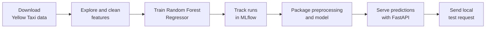

# Model Deployment Project

Use this repository as a **template** for your model deployment project. You will train a regression model that predicts the duration of NYC Yellow Taxi trips, track your experiments locally with MLflow, and serve predictions through a FastAPI app on your own machine. Create pull requests in your own copy even if you are working alone, and use them to track your progress.

## Learning Objectives

By the end of this repository, you should be able to:

- Build an end-to-end regression workflow for real-world taxi trip data.
- Separate exploration, preprocessing, training, and serving concerns into maintainable code.
- Track experiments locally with MLflow and compare model runs.
- Serve model predictions through a local API.

## Learning Path



| File / Folder | Description |
|---|---|
| [**Project Description**](project-description.md) | The assignment tasks, suggested workflow, repository layout, and stretch goals. |

### Additional Folders and Files

| File / Folder | Description |
|---|---|
| [**pyproject.toml**](pyproject.toml) | Project configuration and dependencies. |
| [**uv.lock**](uv.lock) | Dependency lock file. |

## Setup

Use [uv](https://docs.astral.sh/uv/getting-started/installation/) 0.13.5 or newer
and Python 3.13.17 or a newer 3.13 patch release, as defined in
[`.python-version`](.python-version).

> [!NOTE]
> Throughout these steps, text in angle brackets like `<repo-name>` is a **placeholder**. Replace it, including the `< >` brackets, with your own value. For example, `cd <repo-name>` becomes `cd mle-model-deployment-project`.

### 1. Create the Repository from the Template

Click **Use this template** on GitHub.

When creating the repository:

- Set yourself as the **Owner**
- Choose a repository name
- Disable **Include all branches**
- Click **Create repository**

> [!IMPORTANT]
> If you are working in pairs or groups, only **one person** should complete this step.

---

### 2. Add Collaborators (Pairs/Groups Only)

If working with teammates:

1. Open the repository on GitHub
2. Go to **Settings → Collaborators**
3. Add your teammates as collaborators
4. Share the repository link with your team

Teammates should accept the invitation before continuing.

---

### 3. Clone the Repository

Copy the SSH URL from the **Code** button on GitHub, then run:

```bash
git clone <copied-ssh-url>
```

The copied SSH URL will look like `git@github.com:<your-username>/<repo-name>.git`.

---

### 4. Move into the Project Folder and Install Dependencies

This installs all dependencies and creates a virtual environment in `.venv/`.

```bash
cd <repo-name>
uv sync
```

---

### 5. Open the Repository in VS Code

> [!NOTE]
> Make sure you open VS Code from the project root so it automatically detects the environment created by `uv sync`.

Launch VS Code in the project root folder:

```bash
code .
```

If you create a notebook to explore the data, select the Python environment created by `uv sync` as the kernel.

## How to Use This Repo

1. Read the assignment brief in [project-description.md](project-description.md).
2. Download and inspect the January 2025 Yellow Taxi dataset.
3. Train a baseline `RandomForestRegressor` and track runs locally with MLflow.
4. Refactor preprocessing and training logic into reusable Python modules.
5. Build a local prediction API with FastAPI.
6. Send a test request to the API and document the outcome in your README or PR.

### Working Locally

```bash
uv run python -m src.data                          # download January 2025 (about 60 MB) into data/
uv run python -m src.train                         # RandomForest baseline (the assignment) -> MLflow
uv run python -m src.compare --save hgb            # linear vs RandomForest vs HistGradientBoosting, Jan + Feb 2025;
                                                   # saves the HistGradientBoosting model the API serves
uv run python -m src.tune --trials 20              # stretch: Optuna for the RandomForest
uv run python -m src.tune --model hgb --trials 20  # Optuna for HistGradientBoosting
uv run python -m pytest                            # 11 tests
```

MLflow UI (MLflow 3.17 no longer accepts a plain `./mlruns` folder as the tracking store, so runs
are kept in `mlflow.db` with the model files in `mlruns/`):

```bash
uv run mlflow ui --backend-store-uri sqlite:///mlflow.db --port 5000
```

Run the API and send the sample request:

```bash
uv run uvicorn app.main:app --reload --port 8000
curl -X POST http://127.0.0.1:8000/predict -H "Content-Type: application/json" -d @sample-request.json
```

### Docker (macOS and Windows)

```bash
docker compose up -d --build        # API on http://127.0.0.1:8004/docs
docker compose logs -f api          # first start without a model: downloads January and trains (~1 min)
```

The container serves `artifacts/model.skops`. If there is none (for example on a fresh clone),
it downloads January 2025 and trains the HistGradientBoosting model itself, so a new machine
needs no extra steps. For Portainer on Windows, build once with `docker compose build`, then
paste [`portainer-windows.yaml`](portainer-windows.yaml) into a new stack.

## Project Layout

| Path | What it does |
|---|---|
| `src/data.py` | Downloads a month of Yellow Taxi data; adds `duration` (minutes); keeps 1-60 min, 0-100 miles, pickups in that month |
| `src/features.py` | The 5 features used by training and the API: pickup zone, dropoff zone, distance, pickup hour, weekday |
| `src/train.py` | The assignment's `RandomForestRegressor`, logged to MLflow (params, RMSE, MAE, model) |
| `src/compare.py` | More approaches: Ridge (one-hot zones), RandomForest, HistGradientBoosting; January and February 2025 |
| `src/tune.py` | Optuna (20 trials, nested MLflow runs) for the RandomForest or HistGradientBoosting |
| `src/prepare_model.py` | Trains the served model if none exists (used by the Docker entrypoint) |
| `src/model_io.py` | Saves and loads models with skops; only sklearn's two tree node types are trusted |
| `app/` | FastAPI: `GET /health`, `POST /predict`, `POST /predict_batch`; model loaded once |
| `notebooks/01-explore-and-compare.ipynb` | Data checks, cleaning rules, correlations, all MLflow comparisons |
| `tests/` | 11 pytest tests: cleaning, features, model files, API |

## Results

January 2025: 3,475,226 trips, **3,339,084 after cleaning** (96.1%). 80/20 split with seed 42; every
model trains on the same 500,000-row sample and is scored on the full January validation set
(**667,817 trips**) and on all cleaned **February 2025** trips (**3,427,258**, a month no model saw).

| Model | RMSE Jan | RMSE Feb | MAE Jan | Model size | Fit time |
|---|---|---|---|---|---|
| Predict the mean duration | 9.78 | 9.72 | | | |
| Ridge, one-hot zones (reference) | 5.47 | 5.61 | 3.92 | 0.1 MB | 0.3 s |
| `RandomForestRegressor` (100 trees, depth 20, min leaf 10): the assignment baseline | 4.10 | 4.27 | 2.76 | 291 MB | 9.5 s |
| RandomForest tuned with Optuna | 4.03 | | 2.71 | 1,153 MB | 6.7 s |
| **`HistGradientBoostingRegressor` (500 iterations, 127 leaves): served** | **3.78** | **3.96** | **2.53** | **8.6 MB** | 12 s |
| HistGradientBoosting tuned with Optuna | 3.77 | | 2.52 | | 19 s |

Optuna searches (20 trials each on 200,000 rows): RandomForest 4.136-4.333, HistGradientBoosting 3.866-4.015.

**Which model is served?** HistGradientBoosting with default-style settings: it is 8% more
accurate than the RandomForest baseline on January and February and **34 times smaller**
(8.6 MB vs 291 MB; the container uses about 220 MB of memory).

**Was tuning worth it?** No, for either model. The tuned RandomForest gains 1.7% for a 4× larger
file; the tuned HistGradientBoosting gains 0.01 minutes for 1,000 iterations and longer training.

**Does it hold up over time?** Yes: every model loses only 0.14-0.18 minutes of RMSE on February,
so the January model generalises to the next month.

API check (Docker, HistGradientBoosting): `sample-request.json` (zone 161 → 236, 2.5 miles,
Wednesday 08:30) → **19.63 minutes** in 0.02 s. The same trip at 03:00 → 12.65 min and at 17:30 →
17.61 min; JFK (132) → Times Square (230), 17 miles at 17:30 → 50.42 min. Invalid input (zone 999,
distance 0, missing time) → HTTP 422.

### Answers

1. **What is the RMSE of your final model?** **3.78 minutes** on 667,817 January validation trips
   (MAE 2.53) and 3.96 on February 2025, for the served HistGradientBoosting model. The assignment's
   RandomForest baseline reaches 4.10.
2. **What would you do differently with more time?**
   - Add features for the remaining error: route-level average speed by hour, airport flags,
     weather and traffic for the day.
   - Train on several months and validate on the next one, with a monthly drift check.
   - Load the model from the MLflow Model Registry by alias instead of a file (CI already runs
     the tests and checks the Docker image on every push).
